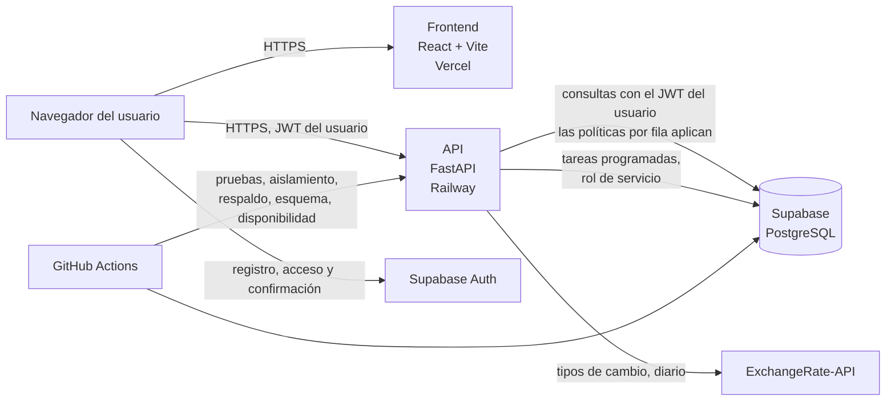

# BackendFinance — Arquitectura y operación (E10, paquete 6.1)

**Para:** quien opere y mantenga la plataforma después de la entrega a Studio A.
**Estado:** versión del 28/11/2026. Lo que cambie después se registra en este archivo.

---

## 1. Componentes

| Componente | Qué es | Dónde vive | Repositorio |
|---|---|---|---|
| **Frontend** | Aplicación React (Vite, TypeScript) con las once pantallas | Vercel, `https://frontend-finance-app.vercel.app` | `backendtrash/FrontendFinanceApp-` |
| **API** | FastAPI (Python 3.12): 11 módulos, 80+ rutas | Railway, `https://backendfinanceapp-production.up.railway.app` | `backendtrash/BackendFinanceApp` |
| **Base de datos y acceso** | PostgreSQL y Supabase Auth (correo y contraseña, confirmación por correo) | Supabase, proyecto `backendfinance-production`, región `us-east-1` | Esquema en `migrations/` del backend |

### Cómo viaja una petición

1. El usuario inicia sesión. Supabase Auth entrega un token de acceso (JWT,
   ES256) y uno de renovación.
2. El frontend manda cada petición a la API con el token de acceso. Si la API
   responde 401 porque venció, el frontend usa el de renovación y repite la
   petición sin que el usuario lo note.
3. La API verifica el token con las claves públicas de Supabase (JWKS) y crea,
   para esa petición, un cliente de base de datos **con el token del propio
   usuario**. Así PostgreSQL aplica las políticas por fila: cada usuario solo
   lee y escribe sus filas.
4. Las conexiones hacia la base salen de un solo pool compartido; los
   encabezados, con el token, son de cada petición (defecto 37).

### Seguridad, en una tabla

| Medida | Dónde |
|---|---|
| Políticas por fila en las 10 tablas | `migrations/`; probadas con dos cuentas reales en `tests/test_isolation.py` (36 casos) |
| Cliente con el token del usuario en cada petición | `app/database.py`; la API falla cerrada si no hay cliente |
| Rol de servicio solo en las tareas programadas y al eliminar una cuenta | `app/scheduler.py`, `app/database.py`; una prueba falla si otro módulo lo usa |
| Tokens ES256 verificados contra JWKS, sin secreto compartido | `app/auth/dependencies.py` |
| Límite de intentos en registro (3/min) y acceso (5/min) | `app/auth/router.py` |
| Encabezados de seguridad (HSTS, no-sniff, sin marcos) | `app/main.py` |
| Aviso de privacidad aceptado al registrarse, con su versión | `app/auth/`, frontend `/privacidad` |

---

## 2. Despliegue

### Flujo de un cambio

1. Rama nueva, cambio y pull request.
2. GitHub Actions corre las verificaciones obligatorias. Sin ellas en verde, el
   PR no se puede integrar.
3. Al integrar a `main`:
   - **Railway** despliega la API, solo cuando el CI de `main` pasa ("Wait for
     CI").
   - **Vercel** construye y publica el frontend.
4. Si el cambio trae una migración, **se corre en el SQL Editor de Supabase
   antes de integrar** (sección 3.4).

### Verificaciones obligatorias

| Repositorio | Verificación | Qué comprueba |
|---|---|---|
| Backend | `tests` | La suite completa (más de 370 pruebas) |
| Backend | `isolation` | Dos cuentas reales contra la base de producción: ninguna ve datos de la otra |
| Backend | `routes` | Cada llamada del frontend tiene su ruta en la API |
| Frontend | `build` | `pnpm build`, que revisa tipos con TypeScript |
| Frontend | `routes` | La misma prueba de rutas, contra el `main` del backend |

### Variables de entorno (sin valores)

Los valores viven solo en Railway, Vercel y los secretos de GitHub. Nunca en
el repositorio ni en este documento.

**API (Railway → servicio → Variables)**

| Variable | Para qué |
|---|---|
| `SUPABASE_URL` | Dirección del proyecto de Supabase |
| `SUPABASE_ANON_KEY` | Clave pública; con ella y el token del usuario aplican las políticas por fila |
| `SUPABASE_SERVICE_ROLE_KEY` | Clave de servicio, solo para tareas programadas y eliminar cuentas. **Nunca al frontend** |
| `ALLOWED_ORIGINS` | Orígenes que pueden llamar a la API (el dominio del frontend) |
| `EXCHANGE_RATE_API_KEY` | Llave de ExchangeRate-API para los tipos de cambio |
| `ADMIN_EMAILS` | Correos que pueden pedir a mano la actualización de tipos de cambio |
| `SCHEDULER_ENABLED` | `true` en producción. **`false` en cualquier copia local** |
| `APP_NAME`, `APP_VERSION`, `DEBUG` | Identificación; `DEBUG=False` en producción |

**Frontend (Vercel → Settings → Environment Variables)**

| Variable | Para qué |
|---|---|
| `VITE_API_BASE_URL` | Dirección de la API |

**GitHub (Settings → Secrets and variables → Actions, en el backend)**

| Secreto | Lo usa |
|---|---|
| `SUPABASE_URL`, `SUPABASE_ANON_KEY`, `SUPABASE_SERVICE_ROLE_KEY` | `isolation` |
| `EXPOS_TEST_USER_A_EMAIL` / `_PASSWORD`, `EXPOS_TEST_USER_B_EMAIL` / `_PASSWORD` | `isolation`: las dos cuentas de prueba |
| `SUPABASE_DB_URL` | `backup` y `schema-check` (cadena del *Session pooler*) |
| `BACKUP_PASSPHRASE` | `backup`: cifra los respaldos. **Si se pierde, los respaldos no se pueden abrir** |

**Supabase → Authentication → URL Configuration:** la *Site URL* y las
*Redirect URLs* deben apuntar al dominio del frontend con `/auth/callback`; de
ahí sale el enlace del correo de confirmación. Al cambiar de dominio, se
actualizan aquí y en `ALLOWED_ORIGINS`.

---

## 3. Operación

### 3.1 Tareas programadas (en la API)

| Hora (UTC) | Hora en Juárez | Tarea |
|---|---|---|
| 00:00 | 17:00 | Genera los movimientos de las reglas recurrentes vencidas. Idempotente: una sola vez por regla y día |
| 06:00 | 23:00 | Actualiza los tipos de cambio contra el peso |
| 08:00 | 01:00 | Revisa los presupuestos y registra alertas |

Al arrancar, la API procesa las reglas que se quedaron pendientes mientras
estuvo apagada. `GET /scheduler` muestra si el programador corre y la próxima
ejecución de cada tarea.

### 3.2 Respaldos

- **Cuándo:** cada domingo a las 09:00 UTC (`backup.yml`), y a mano desde
  Actions.
- **Qué:** las tablas de la aplicación y `auth.users`, cifrados con AES-256
  (`BACKUP_PASSPHRASE`). Cada respaldo se descifra y se lee en la misma
  ejecución: si le falta una tabla, falla.
- **Dónde:** artefacto de la ejecución en GitHub, 90 días.
- **Cómo restaurar:** paso a paso en `docs/respaldos.md`. Antes de restaurar
  sobre producción, sacar un respaldo de su estado actual.

### 3.3 Verificación del esquema (E7)

`schema-check.yml` corre cada domingo, y cada vez que cambia `migrations/`:
aplica las migraciones sobre una base vacía y compara su esquema con el de
producción. Si difieren, falla y deja la diferencia como artefacto.

### 3.4 Migraciones

1. Archivo nuevo en `migrations/`, con el número siguiente; idempotente.
2. Respaldo a mano (Actions → backup).
3. Correrlo en Supabase → SQL Editor, con su vista previa si borra datos.
4. Integrar el PR. `schema-check` confirma que producción y el repositorio
   coinciden.

### 3.5 Monitoreo

| Qué | Dónde |
|---|---|
| ¿La API está arriba? | `GET /health` |
| ¿Las tareas programadas corren? | `GET /scheduler` |
| Tiempo de cada respuesta dentro del servidor | Encabezado `Server-Timing: app;dur=<ms>` |
| Disponibilidad (M5) | `uptime.yml` cada 5 minutos; porcentaje con `python scripts/disponibilidad.py` |
| Registros de la API | Railway → servicio → Deployments → Logs |

---

## 4. Desarrollo local

En los README de los dos repositorios ("The whole system on one machine").
Lo esencial: la base del proyecto es producción, así que localmente
`SCHEDULER_ENABLED=false` y solo con las cuentas de prueba.

---

## 5. Entrega de accesos a Studio A

| Servicio | Qué se transfiere | Cómo |
|---|---|---|
| GitHub | Los dos repositorios | Settings → Collaborators, o Transfer ownership a la cuenta de Studio A |
| Railway | El proyecto de la API y su facturación | Project Settings → Members; luego cambiar el método de pago |
| Vercel | El proyecto del frontend | Settings → Members, o transferir el proyecto |
| Supabase | La organización y el proyecto `backendfinance-production` | Organization → Team, rol Owner |
| ExchangeRate-API | La llave | Cuenta nueva de Studio A y actualizar `EXCHANGE_RATE_API_KEY` |
| Respaldos | La frase `BACKUP_PASSPHRASE` | En persona o por un gestor de contraseñas, nunca por correo |
| Dominio | El registro del dominio | En el registrador, cuando se compre |

Después de transferir, cambiar la contraseña de la base y las claves que
haya visto alguien fuera de Studio A, y actualizar los secretos de GitHub.

---

## 6. Problemas conocidos

Vivos en `docs/defects.md`. Al 28/11 el único abierto es el **37**: la
comparación anual y el panel tardaban más de 500 ms. Su corrección está en el
PR #38.
