# BackendFinance — Manual de usuario (paquete 6.2)

**Para:** las personas que usan BackendFinance para llevar sus finanzas personales.
**Dirección:** `https://frontend-finance-app.vercel.app` · funciona en computadora y en teléfono.

BackendFinance registra tus gastos e ingresos, los ordena por categoría, te
avisa cuando un presupuesto se acerca a su límite y te muestra en gráficas
cómo va tu dinero. Todos los montos se convierten a pesos mexicanos. Tus datos
solo los ves tú.

Las capturas son de una cuenta de prueba con datos de ejemplo. La aplicación
está en inglés; aquí se dice entre paréntesis el nombre de cada botón tal como
aparece.

---

## 1. Crear tu cuenta

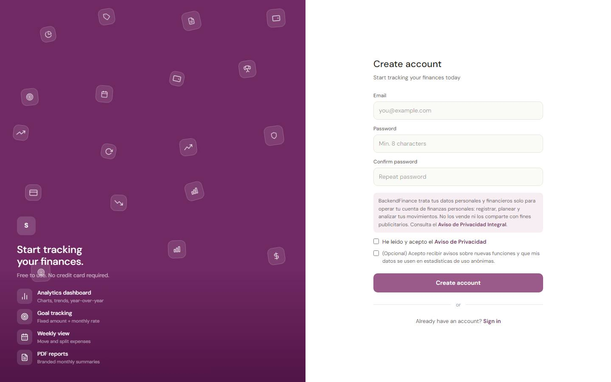

1. Entra a la dirección y elige **Create account**.
2. Escribe tu correo y una contraseña de 8 caracteres o más; repítela.
3. Lee el aviso y marca **He leído y acepto el Aviso de Privacidad**. Sin esta
   casilla no se puede crear la cuenta. La segunda casilla (avisos y
   estadísticas anónimas) es opcional.
4. Revisa tu correo: llega un mensaje de confirmación. Abre su enlace.

## 2. Entrar

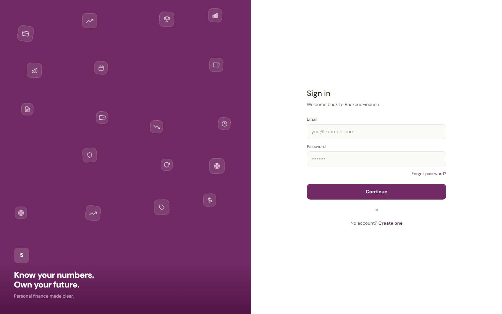

Escribe tu correo y contraseña y elige **Continue**. Tu sesión se renueva sola
mientras usas la aplicación; si cierras el navegador, vuelve a entrar.

En el teléfono, el menú se abre con **☰** (arriba a la izquierda).

---

## 3. Panel principal (Dashboard)

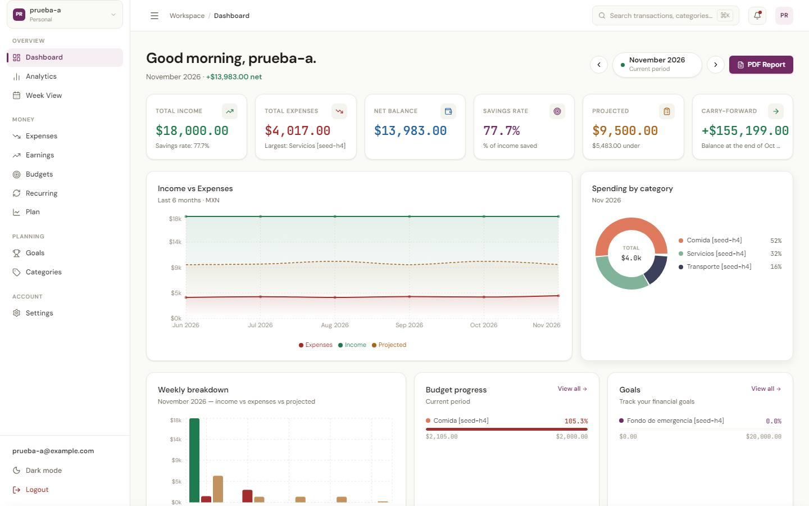

Tu mes de un vistazo. Con las flechas junto al mes cambias de periodo.

- **Tarjetas:** ingresos, gastos, balance, tasa de ahorro, lo proyectado y el
  saldo que traes del mes anterior (*Carry-forward*).
- **Income vs Expenses:** ingresos contra gastos de los últimos seis meses; la
  línea punteada es lo que planeaste gastar.
- **Spending by category:** en qué se fue tu dinero este mes.
- **Weekly breakdown:** el mes semana por semana.
- **Budget progress** y **Goals:** cómo van tus presupuestos y tus metas.
- **PDF Report:** descarga el reporte del mes (sección 13).

## 4. Análisis (Analytics)

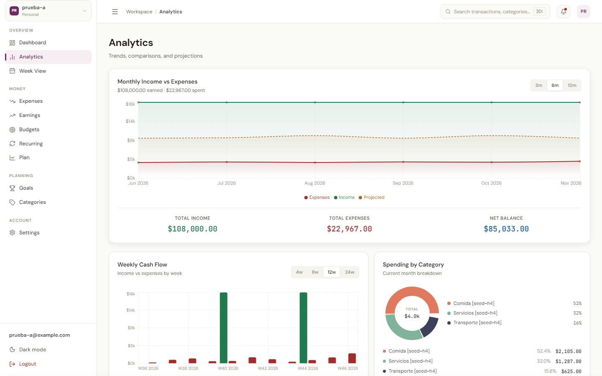

Las gráficas con más detalle: tendencia mensual (3, 6 o 12 meses), flujo
semanal, gasto por categoría, lo proyectado contra lo real, tu patrimonio
acumulado, la comparación con el mismo mes del año anterior y la tendencia de
cada categoría.

## 5. Vista semanal (Week View)

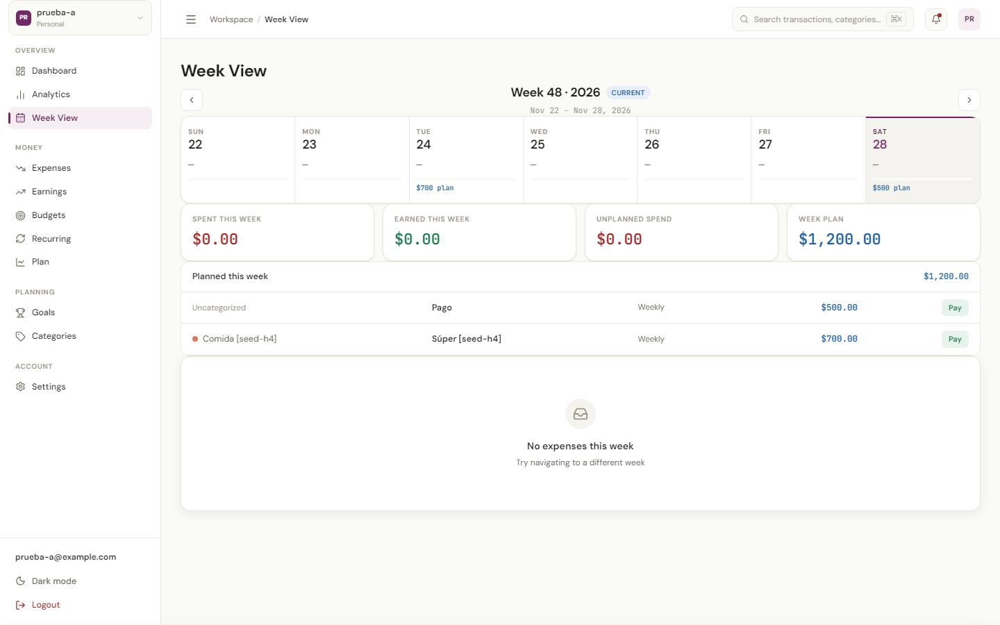

La semana día por día: lo que gastaste, lo que ganaste y lo que tenías
planeado. En **Planned this week** aparecen tus costos planeados de la semana;
con **Pay** registras el gasto cuando lo pagas. El día en que empieza la
semana se cambia en Configuración.

---

## 6. Gastos (Expenses)

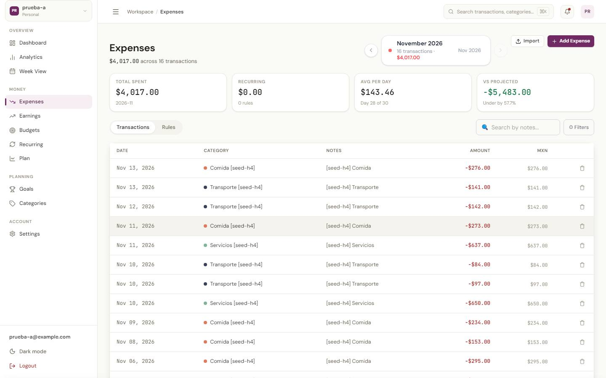

- **Add Expense:** monto, divisa, categoría, fecha y una nota. Si eliges una
  divisa distinta al peso, la aplicación guarda el monto original y su
  equivalente en pesos al tipo de cambio del día.
- **Import:** carga varios gastos desde un archivo CSV o JSON.
- **Filtros:** por nota, categoría, fecha o divisa.
- El bote de basura borra un gasto. Las tarjetas de arriba resumen el mes:
  total, recurrentes, promedio por día y la diferencia contra lo proyectado.

## 7. Ingresos (Earnings)

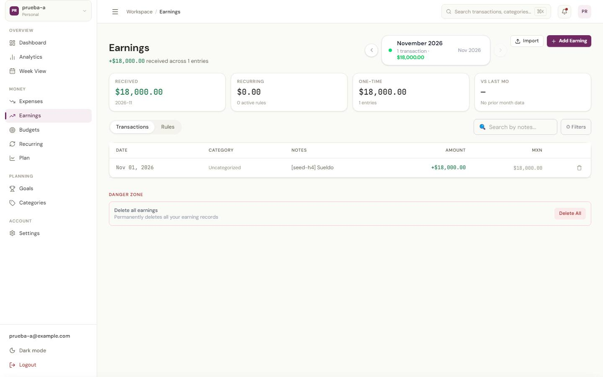

Igual que Gastos, para lo que recibes: sueldo, honorarios, otros ingresos.

## 8. Presupuestos (Budgets)

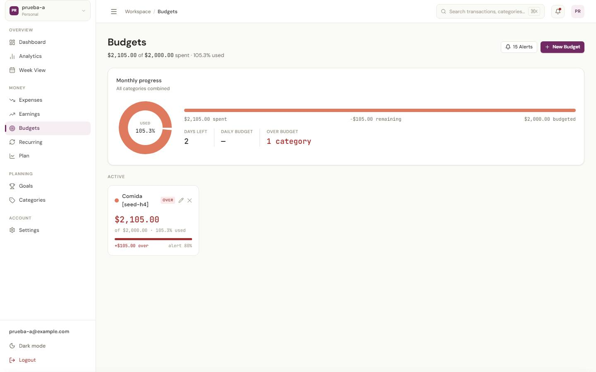

1. **New Budget:** el límite, si es semanal o mensual, la categoría (o todas)
   y el porcentaje al que quieres que te avise (por ejemplo, 80%).
2. La barra muestra cuánto llevas. Al pasar el porcentaje elegido, aparece una
   alerta (la campana de arriba). Si te pasas del límite, el presupuesto se
   marca en rojo.

## 9. Recurrentes (Recurring)

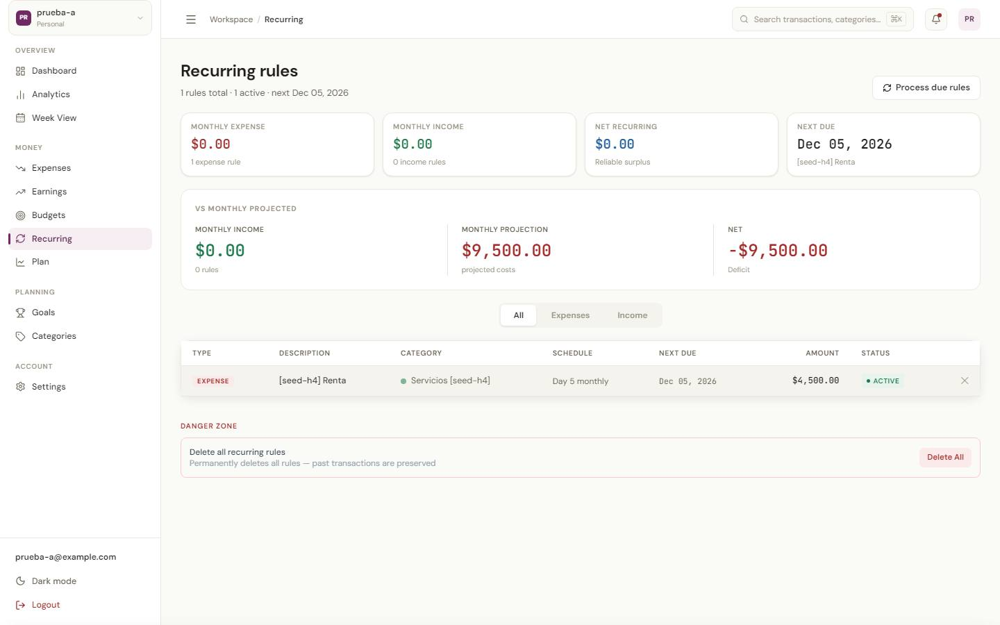

Para lo que se repite: la renta, el sueldo, una suscripción. Creas la regla
una vez (monto, cada semana o cada mes, el día) y la aplicación registra el
movimiento sola en cada fecha. Las tarjetas muestran lo que tus reglas cobran
y pagan en el mes.

## 10. Plan del mes (Plan)

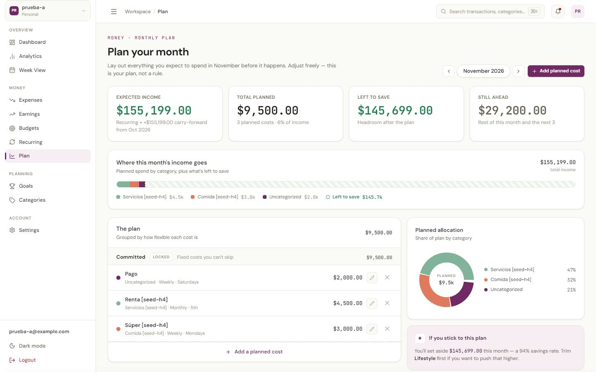

Lo que esperas gastar antes de gastarlo. **Add planned cost** agrega un costo
planeado (único, semanal o mensual). La pantalla muestra lo que tienes
disponible, lo planeado, lo que te queda para ahorrar y lo que viene en los
próximos meses. Lo planeado no cambia tu saldo: solo sirve para comparar.

## 11. Metas (Goals)

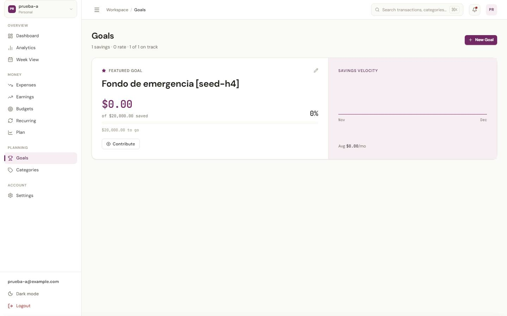

**New Goal:** una cantidad a juntar (con fecha límite si quieres) o un
porcentaje de tus ingresos que quieres ahorrar cada mes. **Contribute** suma
un aporte. La meta muestra cuánto llevas y a qué ritmo.

## 12. Categorías (Categories)

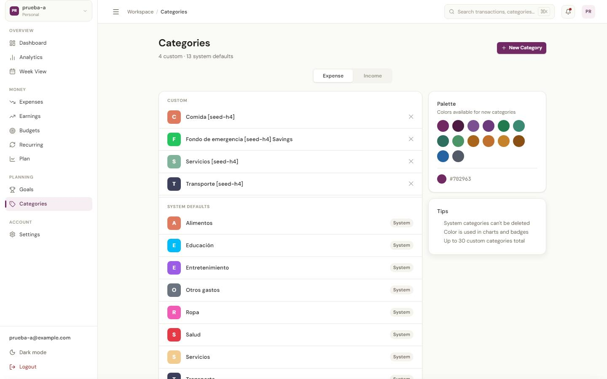

Las de **System** vienen con la aplicación y son las mismas para todos (no se
pueden borrar). Con **New Category** creas las tuyas, de gasto o de ingreso,
con su color. Una categoría que todavía tiene movimientos no se puede borrar:
la pantalla te dice por qué; cambia esos movimientos de categoría primero.

---

## 13. Reporte PDF

En el Panel, **PDF Report** descarga el reporte del mes que estás viendo:
resumen de ingresos, gastos, balance y ahorro; gasto por categoría; avance de
presupuestos y metas; y la lista de gastos e ingresos del mes.

## 14. Configuración (Settings)

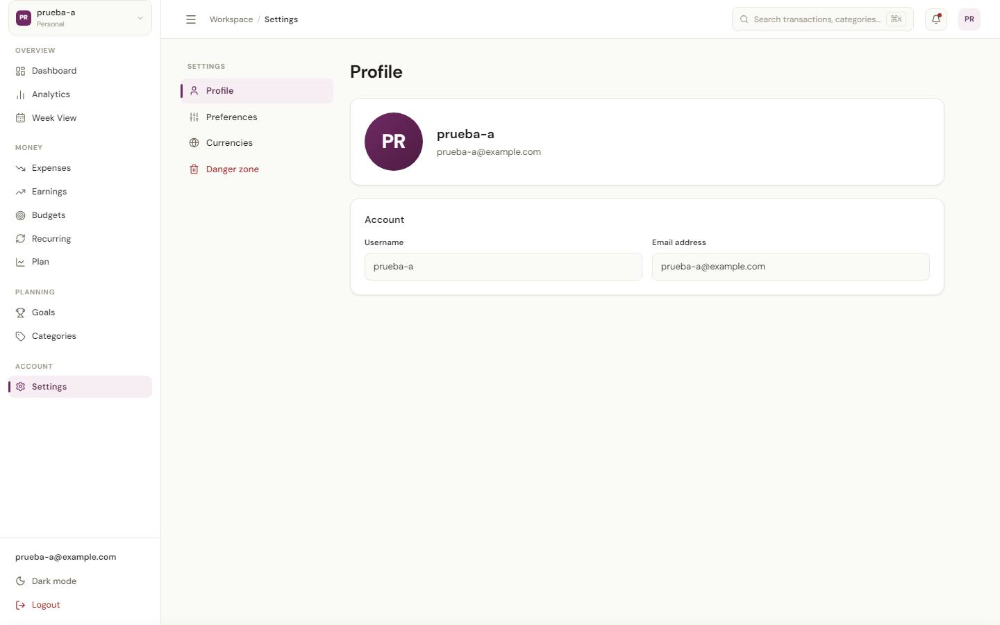

- **Profile:** tu nombre de usuario y correo.
- **Preferences:** el día en que empieza tu semana y el tema claro u oscuro.
- **Currencies:** las divisas disponibles y su tipo de cambio.
- **Danger zone:**
  - **Export all data:** descarga todos tus datos en un archivo.
  - **Delete account:** borra tu cuenta y todos tus datos. No se puede deshacer.

## 15. Aviso de privacidad

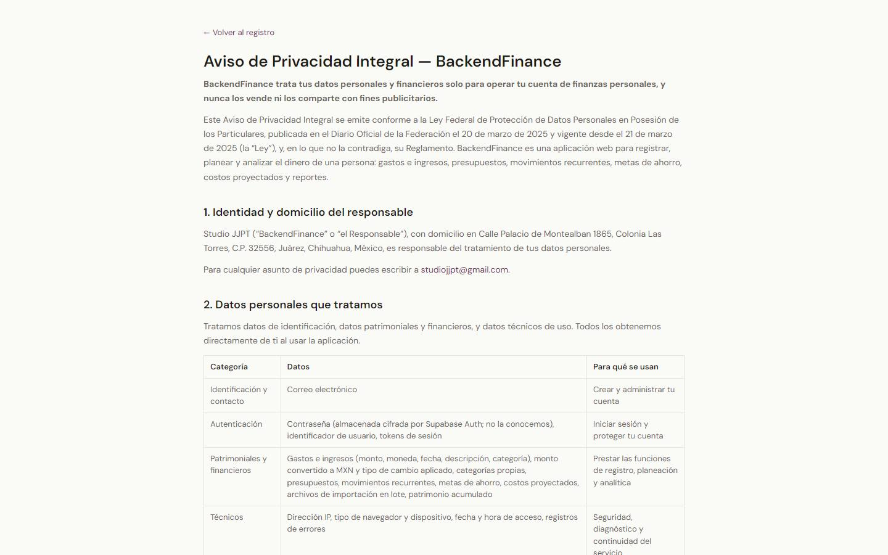

Está en `/privacidad`: quién es responsable de tus datos, para qué se usan y
cómo ejercer tus derechos (acceso, rectificación, cancelación y oposición),
escribiendo al correo que indica.

---

## Preguntas frecuentes

**¿Alguien más ve mis datos?** No. Cada cuenta solo puede leer y escribir lo
suyo; esto se comprueba con pruebas automáticas en cada cambio.

**¿Qué tipo de cambio se usa?** El del día en que registras el movimiento. Se
actualiza una vez al día. Un gasto ya registrado no cambia si después cambia
el tipo de cambio.

**Olvidé mi contraseña.** En la pantalla de acceso, *Forgot password?*.
